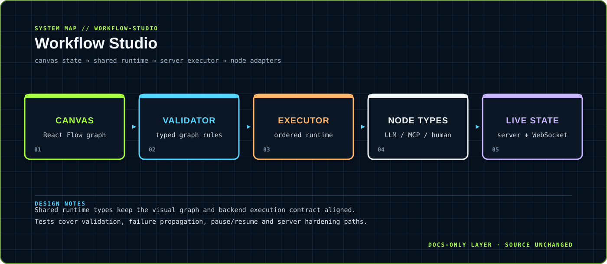

<div align="center">



</div>

# Workflow Studio

> Directed workflow graphs with execution, approvals and observable failure paths.

A TypeScript/React reference starter for validating, executing and observing graphs containing LLM, MCP-tool and human-approval nodes.

<div align="center">

`TypeScript · React · React Flow · Express · WebSocket` &nbsp;·&nbsp; `graph editor → validation → backend executor → live state`

</div>

## `01 / SYSTEM CARD`

- **Primary boundary:** `canvas state → shared runtime → server executor → node adapters`
- **Documentation stance:** architecture and presentation only; application source is intentionally untouched.
- **Visual language:** Y2K terminal grid, brutalist labels, maximalist contrast, readable static SVG fallback.

## `02 / ARCHITECTURE`

The map above is a compact view of the repository's visible runtime boundary. It is designed to answer three questions quickly: where input enters, where policy or domain logic lives, and where external side effects leave the system.


## `03 / DESIGN NOTES`

- Shared runtime types keep the visual graph and backend execution contract aligned.
- Tests cover validation, failure propagation, pause/resume and server hardening paths.

This upgrade adds documentation assets only. It does not change source files, dependency manifests, tests, workflows or runtime configuration.

## `04 / EXISTING PROJECT DOCUMENTATION`

<details open>
<summary>Read the original project notes</summary>

# Workflow Studio

A TypeScript/React reference starter for validating, executing, and observing directed workflow graphs with LLM, MCP tool, and human-approval nodes.

## Scope

This starter includes:

- strict JSON graph, event, tool, and execution-snapshot parsing;
- deterministic DAG validation and ancestor-only data flow;
- bounded LLM/MCP dependency calls with cancellation and timeouts;
- concurrent human approvals and failure propagation;
- an authenticated Express/ WebSocket server with ownership and authorization hooks;
- bounded event retention, backpressure handling, TTL cleanup, keepalive, and replay cursors; and
- a React Flow canvas that reconciles snapshots and reconnects from its last event cursor.

It is a reference/prototype implementation, not a production security boundary. Supply authentication, authorization, durable persistence, tenant isolation, audit logging, deployment isolation, and operational limits appropriate to your environment.

## Verify

Dependencies are exact-pinned in `package-lock.json`:

```sh
npm ci
npm run typecheck
npm test
```

The current local validation covers strict TypeScript checking and 26 tests. Tests use injected LLM/MCP dependencies and do not contact external providers.

## Integration notes

`src/backend/server.ts` requires injected `authenticate`, `authorize`, and `authorizeOrigin` functions for HTTP and WebSocket access. `src/backend/executor.ts` accepts vendor-neutral LLM and MCP client contracts. The in-memory execution store is intentionally non-durable and should not be used as a standalone production persistence layer.

## Security boundaries

Treat workflow definitions, prompts, model results, tool descriptors, tool results, and approval responses as untrusted data. Authorize every execution and approval transition server-side. MCP tools and LLM adapters execute with the privileges granted by the host process; use least-privilege credentials, network restrictions, timeouts, quotas, and human approval for consequential side effects.

</details>

